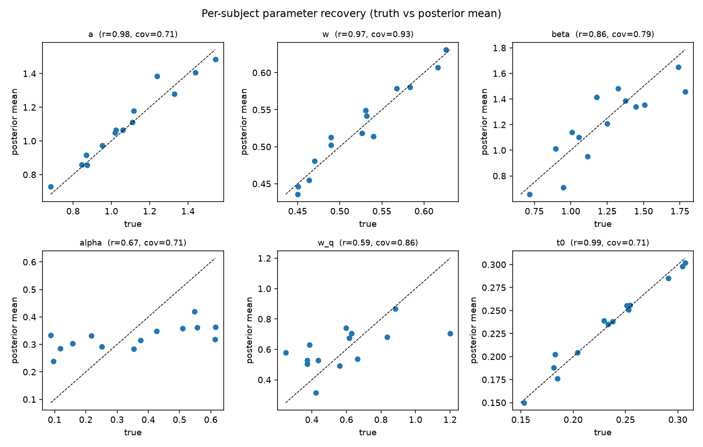
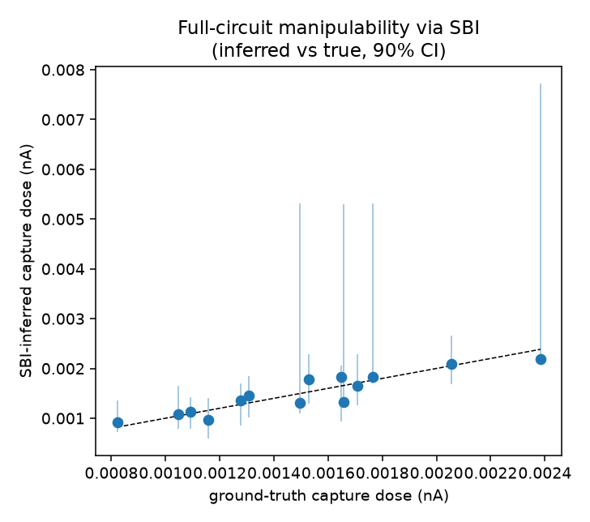

# Individuating the decision process from behavior: recoverability, test-retest reliability, and the limits of inferring susceptibility to covert steering

## Abstract

A person's choices and reaction times carry information about how they decide and how they learn. We ask how far that information supports three increasingly demanding claims: that a model fit to one person recovers their parameters, that it individuates them (predicts the same person better than a group model or another person), and that it estimates how susceptible that person is to covert influence. We fit a hierarchical Bayesian drift-diffusion model with a Rescorla-Wagner learning rule to choices and reaction times, and validate a manipulability measure against a full nonlinear attractor circuit using simulation-based inference. On synthetic agents, decision-state parameters recover well (r = 0.86 to 0.99) and the per-person fit beats an identity-shuffle control (14 of 14). On a real probabilistic reversal-learning dataset with a test-retest design (150 participants), the decision-state fingerprint is reliable across sessions (non-decision time r = 0.71) and individuates: a session-one fit predicts the same participant's session-two behavior better than another participant's fit in 115 of 150 cases. For susceptibility we report a cautionary result. A reduced-model capture dose fails to recover the full-circuit value (rank correlation near zero), whereas computing it directly in the circuit by simulation-based inference recovers the ground truth (rank correlation 0.90). Individuation of the decision process is thus supported, including on real behavior, while susceptibility to covert steering is estimable only in simulation, only in the generative circuit, and never validated on a real person.

## 1. Introduction

Models of the decision process, chiefly the drift-diffusion model and its reinforcement-learning extensions, are routinely fit to human choices and reaction times to read out latent quantities such as evidence-accumulation rate, response caution, and learning rate (Wong and Wang, 2006; Pedersen, Frank, and Biele, 2017). Two questions follow that are usually treated separately. The first is psychometric: are the fitted parameters individually meaningful and stable, so that they describe a person rather than a condition? The second is adversarial: if a model captures how a person decides, does it also tell an outside system how cheaply that person's decisions could be moved? The second question has become concrete as language-model agents are shown to persuade humans toward consequential decisions (Levy, Yang, and Pelrine, 2026), and it motivates asking what a behavioral fit can and cannot reveal about susceptibility.

This paper treats the two questions in one framework and, more importantly, draws the line between what each supports. We fit a hierarchical Bayesian drift-diffusion model with a learning rule to behavior, we quantify recoverability and individuation, and we then ask whether the same fit yields a usable estimate of susceptibility to covert steering. We report one positive result on real data and one cautionary result that bounds the susceptibility claim.

Our contributions are:

1. A hierarchical Bayesian model that jointly infers a per-person decision-state vector and a learning rule from choices and reaction times, with an analytic first-passage likelihood (Navarro and Fuss, 2009) so inference is exact up to Monte-Carlo error.
2. Recoverability and individuation results on synthetic agents with known ground truth, and a test-retest individuation result on a real reversal-learning dataset (Waltmann, Schlagenhauf, and Deserno, 2022).
3. A simulation-based-inference analysis showing that susceptibility, operationalized as a covert capture dose, must be computed in the full generative circuit: a reduced-model estimate does not transfer, while a full-circuit estimate recovers the ground truth.
4. An explicit statement of scope: individuation is supported on behavior, susceptibility is a simulation-only quantity, and susceptibility is never validated on a real person.

## 2. Methods

### 2.1 Decision model

We use the reduced two-variable mean-field decision circuit (Wong and Wang, 2006), in which evidence accumulates with drift v toward one of two boundaries separated by a, from a relative start point w, after a non-decision time t0. The first-passage time and the boundary reached are the reaction time and the choice. The choice-and-reaction-time likelihood is the Wiener first-passage density (Navarro and Fuss, 2009), implemented so that it is differentiable for gradient-based sampling and validated against an Euler-Maruyama simulation of the same process.

### 2.2 Learning rule

Across trials, a Rescorla-Wagner value Q is updated from observed feedback at rate alpha and tilts the drift through a coupling w_q, so the drift on trial t is v_t = w_q (Q1 - Q0)_t + beta c_t, where c_t is a weak perceptual cue. A subject is therefore defined by a state vector (a, t0, w, beta) and a learning rule (alpha, w_q). The update is a convex combination, so the latent value is bounded in the unit interval; this well-posedness is verified in a machine-checked proof.

### 2.3 Inference

Subject parameters are drawn from group-level priors in a non-centered hierarchy and sampled with the No-U-Turn sampler. The learned value is reconstructed deterministically from each subject's observed choices and rewards given alpha, so the learning rate is identified through its effect on the drift. A pooled single-parameter-vector model serves as the group baseline.

### 2.4 Susceptibility

A covert persuasion dose is modeled as an added drive toward a target option at an ambiguous decision. The capture dose is the smallest drive that raises the probability of the target choice to a threshold. In the reduced model this is the analytic hitting probability; in the full circuit it is measured by adding the drive to the generative simulation and bisecting. For the full circuit we infer each subject's parameters by rejection approximate Bayesian computation against a prior bank of simulations, then compute the capture dose from the inferred parameters, propagating posterior uncertainty.

### 2.5 Real data

We use the probabilistic reversal-learning dataset of Waltmann, Schlagenhauf, and Deserno (2022), redistributed under a Creative Commons Attribution licence, in which 150 participants completed the task twice. We model whether a participant repeated their previous choice as a win-stay/lose-shift drift-diffusion process driven by a Rescorla-Wagner value, fit each participant separately in each session by maximum likelihood, and evaluate cross-session individuation.

### 2.6 Use of large language models

Code and manuscript text were prepared with the assistance of a large language model (Claude). All generated code was executed and checked against held-out simulations and against the recomputed results reported here, and the author is accountable for the full content.

## 3. Results

### 3.1 Parameter recovery (synthetic)

With 14 synthetic subjects of 300 trials each and converged sampling (group-mean potential-scale-reduction 1.004), the decision-state parameters recover with correlations of 0.86 to 0.99 between the true and posterior-mean values, and the learning-rule parameters recover moderately (learning rate 0.67, value coupling 0.59). The ordering is consistent: parameters that shape the reaction-time distribution are easiest, and the learning rule is the hard part. We checked robustness across four independent synthetic cohorts. Three of the four replicate the recovery (state-parameter correlations of 0.86 to 0.99, learning rate 0.66 to 0.91); the fourth failed sampler convergence outright, with a non-finite group-level potential-scale-reduction and a degenerate non-decision-time posterior, even at an increased sampling budget. We report this rather than discard it silently: at a cohort size of 14 the hierarchical sampler is not guaranteed to converge on every draw, so convergence must be checked per cohort and the point estimates above should be read as representative of converged cohorts. We also report posterior-interval coverage rather than correlations alone: at a nominal 90 percent level the per-parameter coverage ranges from 0.71 to 0.93 (mean 0.79), so the posteriors are mildly overconfident at this sample size and the intervals should be read as approximate, not exactly calibrated.

### 3.2 Individuation out-of-sample (synthetic)

Fitting on the first 70 percent of trials and scoring the last 30 percent, the per-person fit predicts each subject's held-out behavior better than another subject's fit (identity-shuffle control) in all 14 of 14 cases (binomial p = 1.2e-4). This identity-shuffle margin is the load-bearing test, because it isolates the identity of the subject from generic structure that a group model would also capture. The per-person fit also beats a pooled group model in 10 of 14 subjects, but at this sample size that comparison is not significant on its own (binomial p = 0.18) and we do not rely on it; the identity-shuffle result is the one that establishes individuation here.

### 3.3 The reduction does not recover susceptibility

Across 14 full-circuit settings, a capture dose predicted by a reduced-model fit to behavior fails to recover the capture dose measured directly in the attractor circuit: the rank correlation is -0.25 (p = 0.40, n = 14), a null rather than a positive association, with both quantities showing substantial spread. This is an underpowered null on its own, so we do not claim negative transfer; the force of the result is the contrast with Section 3.4, where the full-circuit route recovers the same ground-truth capture dose at rank correlation 0.90 on the same number of settings. At equal sample size, one route recovers susceptibility and the other does not. Approximate Bayesian computation does recover the circuit's own parameters from behavior (noise recovery r = 1.00, inhibition recovery r = 0.66), so the circuit is identifiable and the failure is specific to passing the capture dose through the reduction.

### 3.4 Susceptibility computed in the full circuit recovers ground truth

When the capture dose is computed in the full circuit from the approximate-Bayesian-computation posterior rather than through the reduction, it recovers the ground-truth capture dose with rank correlation 0.90 and Pearson correlation 0.92, with a median absolute error of 0.0001 and 90 percent posterior intervals that contain the truth for all 14 subjects. The recovery is stable across seeds (rank correlation 0.82 to 0.93, median 0.86, over four independent cohorts), in clear contrast to the reduction route's null (Section 3.3) at the same sample sizes. Susceptibility is therefore estimable in simulation, but only when computed in the generative model, not its reduction.

### 3.5 Individuation on real behavior

On the reversal-learning dataset, the decision-state parameters are reliable across sessions (non-decision time r = 0.71, boundary r = 0.60, baseline drift r = 0.51), while the learning-rule parameters are not (learning rate r = 0.15, value coupling r = -0.01). The per-person fit from session one predicts the same participant's session-two behavior better than another participant's fit in 115 of 150 cases, a mean advantage of 0.37 nats per trial. Individuation of the decision-state fingerprint therefore holds on real human behavior, while the learning-rule layer does not individuate reliably.

## 4. Discussion

The results separate cleanly into what behavior supports and what it does not. Behavior supports individuation of the decision process: a fitted decision-state fingerprint is recoverable in simulation, reliable across sessions in real participants, and specific enough to re-identify a person. Behavior supports learning-rule inference only weakly, in simulation and not reliably on real data, which is consistent with the limited reliability of computational reinforcement-learning readouts reported for this task (Waltmann, Schlagenhauf, and Deserno, 2022).

Susceptibility to covert steering is a different kind of claim and must be treated differently. We find that a susceptibility estimate derived from a reduced model fails to recover the generative circuit's capture dose, even when the reduced model fits the behavior well, whereas a susceptibility estimate computed in the generative circuit from simulation-based inference recovers the ground truth at the same sample size. The practical lesson is that a model that predicts choices is not thereby a model that predicts manipulability; the latter is a derivative quantity that depends on the full dynamics near the decision boundary. The methodological lesson is that simulation-based inference, which fits the generative model directly, is the appropriate tool for susceptibility, and the analytic reduction is appropriate for individuation.

### 4.1 Limitations

The synthetic results share a functional form between the generating and fitting models, so recovery there is a necessary check rather than evidence that the form is correct for people. On real data the learning-rule parameters are unreliable, so the learning-rule layer is not yet a dependable individual readout. Susceptibility is never validated on a real person: a ground-truth capture dose would require an actual covert-steering intervention, which we do not perform and which raises its own ethical questions. The susceptibility figures are therefore properties of the models, not calibrated statements about any real individual. No neural data is used.

### 4.2 Ethics and intended use

The same quantity that an adversary would want, how cheaply a decision can be flipped, is the quantity a monitor uses to detect steering before it succeeds; in our simulations a monitor that observes on the order of ten of a person's decisions detects the covert drive before it flips the choice for most subjects. We present the individuation result, which works on real behavior, together with the explicit finding that susceptibility is a simulation-only quantity, precisely so that the manipulation-relevant claim is not read as more established than it is. We release code and aggregate results; we do not redistribute the human dataset, which remains available from its original source under its own licence.

## 5. Conclusion

From choices and reaction times, a hierarchical Bayesian decision model individuates a person, on synthetic agents and on real test-retest behavior. The further step of estimating susceptibility to covert steering is estimable only in simulation and only when computed in the generative circuit rather than its reduction, and is not validated on real people. Keeping these claims separate is, in our view, the responsible way to study behavioral individuation that touches on manipulation.

## Declarations

**Funding.** No funding was received to assist with the preparation of this manuscript.

**Competing interests.** The author has no relevant financial or non-financial interests to disclose.

**Ethics approval.** This work is a secondary computational analysis of a publicly available, de-identified behavioral dataset and of synthetic data generated by the author. No new data were collected from human participants. No ethics approval was required.

**Consent to participate and consent to publish.** Not applicable. No new human participants were involved, and no individual-level or identifying data are reported; all human-data results are aggregate statistics over a public dataset.

**Data and code availability.** Code and aggregate results are available in the author's cognitive-influence-lab repository. The human dataset is the probabilistic reversal-learning data of Waltmann, Schlagenhauf, and Deserno (2022), available under a Creative Commons Attribution 4.0 licence from the original authors (https://osf.io/4ng3e/); it is not redistributed here. No individual-level data are reported, only aggregate statistics.

**Author contributions.** A.G. conceived the study, implemented the models and analyses, and wrote the manuscript.

**Use of large language models.** A large language model (Claude) was used to assist with code implementation and manuscript drafting. The author reviewed, verified, and takes full responsibility for all content, including every reported result and claim.

## References

Cranmer, K., Brehmer, J., and Louppe, G. (2020). The frontier of simulation-based inference. Proceedings of the National Academy of Sciences, 117, 30055-30062.

Levy, J., Yang, M., and Pelrine, K. (2026). AI persuasion as a threat to human control. arXiv:2609.14796.

Navarro, D. J., and Fuss, I. G. (2009). Fast and accurate calculations for first-passage times in Wiener diffusion models. Journal of Mathematical Psychology, 53, 222-230.

Pedersen, M. L., Frank, M. J., and Biele, G. (2017). The drift diffusion model as the choice rule in reinforcement learning. Psychonomic Bulletin and Review, 24, 1234-1251.

Waltmann, M., Schlagenhauf, F., and Deserno, L. (2022). Sufficient reliability of the behavioral and computational readouts of a probabilistic reversal learning task. Behavior Research Methods, 54, 2993-3014.

Wiecki, T. V., Sofer, I., and Frank, M. J. (2013). HDDM: Hierarchical Bayesian estimation of the drift-diffusion model in Python. Frontiers in Neuroinformatics, 7, 14.

Wong, K.-F., and Wang, X.-J. (2006). A recurrent network mechanism of time integration in perceptual decisions. Journal of Neuroscience, 26, 1314-1328.
